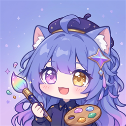

<p align="center">
  
</p>

<h1 align="center">AGY Icon Studio · 插件图标工坊</h1>

<p align="center">
  为 <strong>Google Antigravity</strong> 插件一站式体检、生成、更换与备份恢复自定义图标。<br />
  内置「AI 娘宇宙」与多种精品画风预设 · 跨平台 256×256 自动缩放 · 上游更新覆盖后一键还原保险箱。
</p>

---

## ✨ 为什么需要这个插件？

很多优秀插件或官方扩展在列表里要么没有本地图标（退化成纯色首字母方块），要么只有一个简陋的几何 SVG，风格也五花八门。即使自己画了一套统一风格的图标，每次上游插件更新覆盖目录，图标又被打回原形。

**AGY Icon Studio** 把整套流程标准化、自动化：

1. **全盘图标体检（`scan`）**：一键扫描已安装插件，自动识别缺失图标（`missing`）、简陋矢量（`local-svg`）、失效路径（`broken`）、外链（`remote-https`）以及**是否被上游更新冲掉自定义图标（`drifted`）**。
2. **统一画风生成（`SKILL.md` + 参考画风库）**：自带 **「AI 娘宇宙」**（Gemini 蓝紫猫娘、GPT 银发龙角小龙娘、Claude 橙发大小姐等）与 **3D 潮玩 / 毛玻璃极简 / 像素风** 精确 Prompt 模板，批量出图、逐张核对、风格高度统一。
3. **跨平台 256×256 PNG 自动规范化（`apply`）**：零第三方 npm 依赖，自动按当前系统调用原生高质量双三次缩放（Windows `System.Drawing` / macOS `sips` / Linux `ImageMagick`·`Pillow`·`ffmpeg`），写入目标插件 `assets/logo.png` 并同步更新 `plugin.json`。
4. **本地图标保险箱（`~/.gemini/icon-vault/`）**：
   - 每次换图标都会同时留存 **原始版本** 与 **定制版本（`custom/logo.png` + SHA256 指纹）**；
   - 插件更新被覆盖？运行一次 `restore --all` 秒级还原全部定制图标；
   - 想恢复出厂？运行 `revert --dir <插件目录>` 无损回滚。

---

## 📦 安装方式

### 方式一：通过 AGY Market（推荐）
打开 **AGY Market** 侧边栏，点击右上角 **「链接添加（Add from GitHub URL）」**，贴入仓库地址即可安装：
```text
https://github.com/AEmbers/agy-icon-studio
```

### 方式二：手动克隆并部署到本地插件目录

**Windows（PowerShell）：**
```powershell
git clone https://github.com/AEmbers/agy-icon-studio.git
powershell -ExecutionPolicy Bypass -File .\agy-icon-studio\scripts\install-local.ps1
```

**macOS / Linux：**
```bash
git clone https://github.com/AEmbers/agy-icon-studio.git ~/.gemini/config/plugins/agy-icon-studio
```

---

## 🚀 对话示例（装好就能直接使唤 Agent）

- `扫描我本机所有插件的图标状态，看看哪些缺图标或被更新覆盖了`
- `按「AI 娘宇宙」统一画风，给没有图标的插件批量设计并换上 256×256 高清图标`
- `帮我把刚才给 xxx 插件新画的这张图设为图标并存进保险箱`
- `检查我的图标保险箱，把被上游更新覆盖的自定义插件图标一键还原`

---

## 🛠️ CLI 命令行速查

底层管理工具位于 `bin/icon-studio.mjs`（所有命令均支持 `--json` 机器可读输出）：

```bash
# 1. 全盘体检
node bin/icon-studio.mjs scan

# 2. 给指定插件更换图标（自动缩放为 256x256 PNG、备份原版并入库保险箱）
node bin/icon-studio.mjs apply --dir <plugin-dir> --src <image-path> --style "ai-girls-universe"

# 3. 将已有自定义图标直接归档进保险箱托管
node bin/icon-studio.mjs vault import-current --dir <plugin-dir> --style "ai-girls-universe"

# 4. 查看保险箱库存与漂移状态
node bin/icon-studio.mjs vault list

# 5. 上游更新后，一键批量还原所有自定义图标
node bin/icon-studio.mjs restore --all

# 6. 无损回滚单个插件到更换前的原始图标
node bin/icon-studio.mjs revert --dir <plugin-dir>
```

---

## ❓ 常见问题 (FAQ)

- **换完图标后，Antigravity 原生「自定义扩展」页面还是旧图标？**
  修改 `plugin.json` 与 `assets/logo.png` 后，后台 Language Server 会立即读到最新图标，但桌面客户端的「自定义扩展」页面存在前端快照缓存。在 Antigravity 窗口按下 **`Ctrl+R`**（macOS 为 `Cmd+R`）刷新或重启一次窗口即可同步显示；在 **AGY Market** 面板只需点击右上角刷新按钮。

---

## 🎨 致敬与社区礼仪

内置 `references/ai-girls-universe.md` 中的 Gemini 蓝紫异瞳猫娘、GPT 银发小龙娘、Claude 橙发大小姐等社区人气拟人设定，灵感与视觉特征源自 B 站创作者 **@ZipZipPipe** 的《大AI和小AI们》企划及广大小伙伴的开源二创生态。请在非商业、个人桌面美化与交流分享场景中友好使用，尊重原作者创作署名。

---

## 📄 License

[MIT](LICENSE) © 2026 AEmbers
